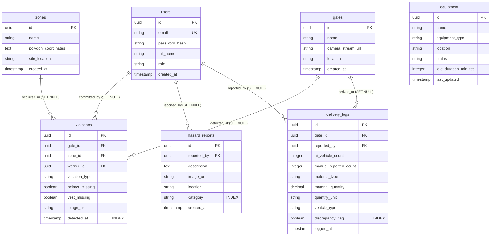

# Entity-Relationship (ER) Diagram & Schema Documentation

**Project:** AI-Powered Construction Site Intelligence Platform  
**Phase:** Phase 2 — Database Design & Migrations  
**Schema Version:** 2.0 (Updated with Material Tracking Inflow Log)  

---

## 1. Entity-Relationship Diagram (Mermaid)

---

## 2. Table Specifications & Security Design

### `users`
Stores system accounts for role-based access control.
- `id` (UUID, Primary Key)
- `email` (VARCHAR(255), Unique, Indexed)
- `password_hash` (VARCHAR(255), Bcrypt hashed - no plaintext passwords)
- `full_name` (VARCHAR(255))
- `role` (VARCHAR(50), Enum: `admin`, `supervisor`, `worker`)
- `created_at` (TIMESTAMP)

### `zones`
Defines restricted geographic polygons on site.
- `id` (UUID, Primary Key)
- `name` (VARCHAR(255))
- `polygon_coordinates` (TEXT, JSON array of `[x, y]` coordinates)
- `site_location` (VARCHAR(255))
- `created_at` (TIMESTAMP)

### `gates`
Represents site entry points tied to a physical gate camera stream.
- `id` (UUID, Primary Key)
- `name` (VARCHAR(255))
- `camera_stream_url` (VARCHAR(500), RTSP/HTTP feed URL)
- `location` (VARCHAR(255))
- `created_at` (TIMESTAMP)

### `violations` (Audit Trail)
Logs every PPE and restricted zone safety violation.
- `id` (UUID, Primary Key)
- `gate_id` (UUID, FK -> `gates.id` **`ON DELETE SET NULL`**)
- `zone_id` (UUID, FK -> `zones.id` **`ON DELETE SET NULL`**)
- `worker_id` (UUID, FK -> `users.id` **`ON DELETE SET NULL`**)
- `violation_type` (VARCHAR(50), `ppe_missing` / `restricted_zone_entry`)
- `helmet_missing` (BOOLEAN)
- `vest_missing` (BOOLEAN)
- `image_url` (VARCHAR(500))
- `detected_at` (TIMESTAMP, **INDEXED**)

### `hazard_reports` (Audit Trail)
Stores worker-submitted safety hazards and AI-assigned categories.
- `id` (UUID, Primary Key)
- `reported_by` (UUID, FK -> `users.id` **`ON DELETE SET NULL`**)
- `description` (TEXT)
- `image_url` (VARCHAR(500))
- `location` (VARCHAR(255))
- `category` (VARCHAR(50), **INDEXED**, `fire_risk`, `unsafe_wiring`, `water_leakage`, `scaffold_damage`, `structural_cracks`, `other`)
- `created_at` (TIMESTAMP)

### `delivery_logs` (v2 Fraud & Material Tracking Audit Trail)
Tracks automated vehicle count vs. supervisor manual report and material inflow.
- `id` (UUID, Primary Key)
- `gate_id` (UUID, FK -> `gates.id` **`ON DELETE SET NULL`**)
- `reported_by` (UUID, FK -> `users.id` **`ON DELETE SET NULL`**)
- `ai_vehicle_count` (INTEGER, auto-populated by CV pipeline)
- `manual_reported_count` (INTEGER, logged by supervisor)
- `material_type` (VARCHAR(50), e.g., `cement`, `sand`, `bricks`, `steel`, `pipes`, `other`)
- `material_quantity` (DECIMAL(10,2))
- `quantity_unit` (VARCHAR(20), `bags`, `tons`, `cubic_meters`, `pieces`)
- `vehicle_type` (VARCHAR(50), optional AI classification e.g., `mixer`, `tipper`, `open_bed`)
- `discrepancy_flag` (BOOLEAN, **INDEXED**, computed strictly from `ai_vehicle_count != manual_reported_count`)
- `logged_at` (TIMESTAMP)

### `equipment`
Tracks machinery status and spatial activity.
- `id` (UUID, Primary Key)
- `name` (VARCHAR(255))
- `equipment_type` (VARCHAR(100), `excavator`, `bulldozer`, `crane`, `truck`)
- `location` (VARCHAR(255))
- `status` (VARCHAR(50), `active`, `idle`)
- `idle_duration_minutes` (INTEGER)
- `last_updated` (TIMESTAMP)

---

## 3. Database Security & Audit Trail Integrity
1. **Evidence Preservation:** Foreign keys on all audit tables (`violations`, `hazard_reports`, `delivery_logs`) enforce `ON DELETE SET NULL`. If a user or gate entity is deleted, historical safety evidence and fraud records remain intact for auditing.
2. **Credential Security:** All user passwords are encrypted using Bcrypt prior to persistence. Plaintext passwords are strictly forbidden across seed files and application logic.
3. **Least-Privilege Principle:** Database connections operate under dedicated application user roles restricted from DDL alterations during runtime.
